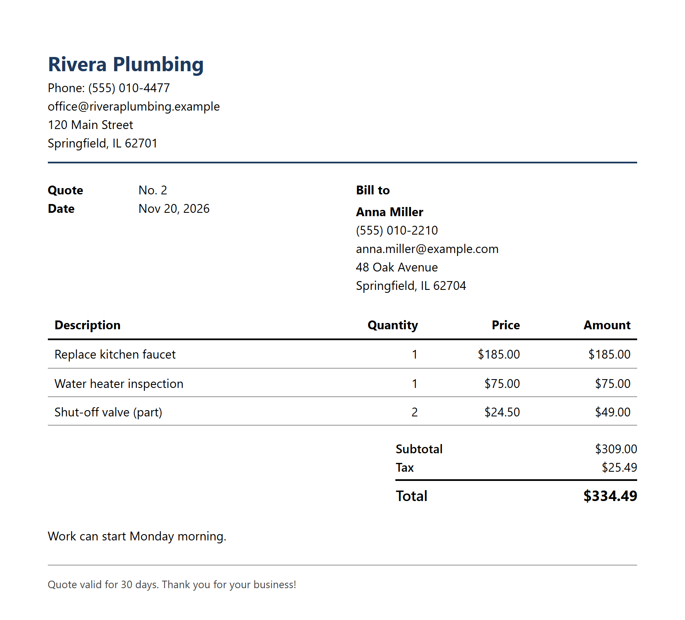
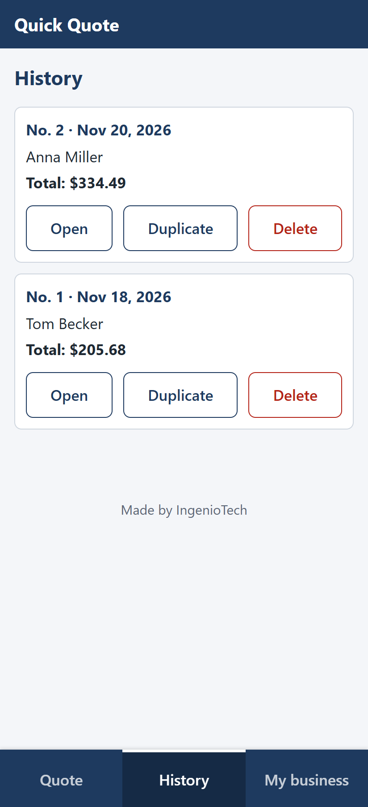
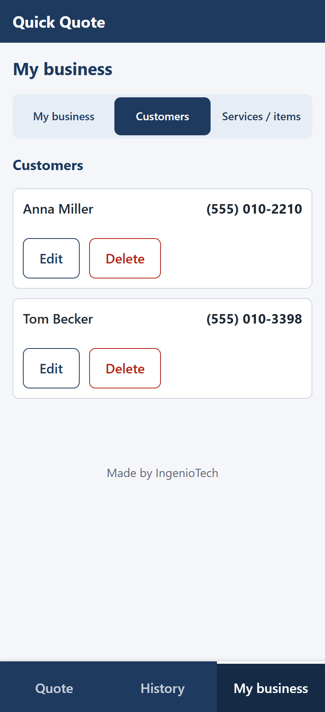

# Quick Quote (Cotiza Rápido)

A free web app for tradespeople (plumbers, painters, gardeners and similar) to write a quote on their phone and send it by WhatsApp or as a PDF.

## Screenshots

With sample data: a printed quote, and the history and saved customers on a phone.

<p>  </p>

## What it does

- **Quotes with line items and tax.** Add and remove lines with a description, quantity and price. The subtotal, tax and total update as you type. You set the tax percentage once in the business section.
- **Saved services and customers.** Saved services are suggested in each line's description, and choosing one fills in its price. Customers are saved with each quote (name, phone, email, address, city, state and ZIP) and suggested by name; choosing one fills in all their details. Saved services and customers can be edited or deleted.
- **Your business details.** Name, phone, email, address, city, state and ZIP, set once in the business section, which has three tabs: business details, customers and services.
- **Quote date.** A new quote starts with today's date, which you can change.
- **History.** Saved quotes get a consecutive number and are listed newest first. You can open, duplicate or delete each one. Opening an older quote fills any missing customer details from the customer's current record.
- **WhatsApp message.** One button opens WhatsApp with the quote written out as a message, addressed to the customer's phone.
- **Print or save as PDF.** The quote prints as a clean sheet with your full business details, quote number and date, a "Bill to" block with the customer's details, a table of lines, totals, notes and the footer note.
- **Spanish and English.** Choose the language in the business section. Spanish is the default.
- **Installable and usable offline.** The app can be installed from the browser, and a service worker keeps its files so it opens without an Internet connection.

## Privacy

Everything is stored on the device with `localStorage`. There is no server, no account and no tracking. Clearing your browser data deletes all saved quotes, customers, and services.

## Run it locally

You need Node.js 22 or newer. There are no dependencies to install.

```sh
npm start
```

Then open http://localhost:8080.

To run the tests:

```sh
npm test
```

## How it was built

All of the app's code was written through [AI Router](https://github.com/ricdegre/AI-Router), a local tool that sends each task to an AI model chosen for it, using flat-rate subscriptions and a local model instead of pay-per-use APIs. The author gave each task in plain language from VS Code and checked every result by hand, first on a computer and then on an Android phone (installed, and offline in airplane mode).

The design is in [PLAN.md](PLAN.md) and the original task list in [TASKS.md](TASKS.md). What each task cost in time, which model did it and what went wrong is in the [case study](https://github.com/ricdegre/AI-Router/blob/main/docs/CASE_STUDY_QUICK_QUOTE.md).

## Author

Made by Richard R Degregorio (IngenioTech). I am not a software developer. I solve the problems that come up in my work with the tools I have, and look for new tools when those are not enough. I directed this project, tested every step by hand, and the code was written by AI models.

## License

Released under the [MIT License](LICENSE). Copyright (c) 2026 Richard R Degregorio.
